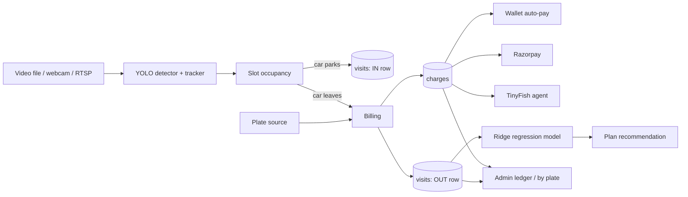

# 🚗 Smart Parking

A single-file Flask app that turns parking-lot video into a live, billed, bookable parking system.
A camera feed goes in; occupied slots, parking durations, number plates, wallets, Razorpay payments,
parking plans and an admin dashboard come out.

> **Status:** working prototype / demo. It is built to run on recorded videos (and can read a webcam or RTSP stream).
> Read [Limitations](#limitations-and-honest-notes) before using it for anything real.

---

## Contents
1. [What it does](#what-it-does)
2. [How it works](#how-it-works)
3. [Tech stack](#tech-stack)
4. [Repository layout](#repository-layout)
5. [Quick start](#quick-start)
6. [Configuration (.env)](#configuration-env)
7. [Parking lots and cameras](#parking-lots-and-cameras)
8. [Billing](#billing)
9. [Payments: wallet, Razorpay, TinyFish](#payments-wallet-razorpay-tinyfish)
10. [Admin payments page](#admin-payments-page)
11. [Smart parking via machine learning](#smart-parking-via-machine-learning)
12. [In / Out log](#in--out-log)
13. [Pages and API](#pages-and-api)
14. [Database](#database)
15. [Testing](#testing)
16. [Deployment notes](#deployment-notes)
17. [Limitations and honest notes](#limitations-and-honest-notes)
18. [Roadmap](#roadmap)

---

## What it does

**For drivers**
- Register, sign in, and see nearby parking lots, sorted by distance or by price.
- Open a lot with a live camera to see its slots in real time, and book a free slot.
- Hold a prepaid **wallet**, top it up, and have each stay billed automatically by number plate.
- Pay pending charges from the wallet or with **Razorpay**.
- Get **plan recommendations** from a machine-learning model that learns their own parking history, and buy a plan (Razorpay or wallet).
- Download receipts for stays and bookings.

**For admins** (the first account that registers becomes the admin)
- Live camera view with slots drawn automatically or by hand.
- **Payments page**: a real-time "parked now" meter, a full **ledger** of every charge, a **by-number-plate** view, a wallet history, a permanent **In / Out log**, CSV exports and per-plate statements.
- A ready-made **test driver** with wallet money, attachable to any plate.
- Mark charges paid in cash, send payment reminders (e-mail / SMS), review data quality per lot.
- Wrong-parking alerts (optionally a voice call to the guard), booking management, discovery and approval of nearby lots.

**Optional AI agent (TinyFish)**
- Finds nearby parking lots on the web, and can open the payment page and settle a charge on the driver's behalf.

---

## How it works



1. **Detection.** OpenCV reads the video. A YOLO model (Ultralytics) detects vehicles; a tracker (ByteTrack, BoTSORT or a built-in IoU tracker) follows them.
2. **Occupancy.** A slot becomes *occupied* once a vehicle stays inside it for `PARK_SECS` seconds, and *free* again after a short grace period (`OCC_GRACE`).
3. **Identity.** Each parked car gets a number plate: read from a gate camera in two-camera lots, or taken from a fake-vehicle pool (plate, owner, phone) stored in the database for single-camera demo lots.
4. **Entry.** An **IN** row is written to the `visits` table.
5. **Exit.** When the car leaves (or the video loops, or the app restarts), the **OUT** row is written, the duration is priced, and a charge is created with the plate and lot.
6. **Settlement.** The plate's owner is billed from their wallet. If the wallet is short, the charge stays **PENDING** until paid with Razorpay, the wallet, cash (admin), or the TinyFish agent.
7. **Learning.** Each visit updates the owner's usage model, which forecasts the next 30 days and recommends the cheapest plan.

Everything runs in one Python process with SQLite for storage. Durations use **video seconds**, the same clock the billing uses.

---

## Tech stack

| Area | Technology |
|---|---|
| Web app | Python, Flask, server-rendered pages with small vanilla-JS front ends |
| Vision | OpenCV, Ultralytics YOLO (`yolov8s.pt` by default) |
| Plate reading (two-camera lots) | EasyOCR, or pytesseract + Tesseract |
| Database | SQLite (`parking.db`) |
| Payments | Razorpay (orders, signature verification, webhook), prepaid wallet |
| Machine learning | scikit-learn `Ridge` regression on NumPy features |
| Notifications | SMTP e-mail, Twilio (voice call to guard, SMS reminders) |
| AI agent (optional) | TinyFish |

---

## Repository layout

```
.
├── car.py              # the whole application (server, detector, billing, pages)
├── test_payments.py    # automated checks (fake Razorpay, runs on a temporary copy)
├── env.example         # settings template -> copy the lines you need into .env
├── requirements.txt
├── videos/
│   ├── lot1/           # one folder per parking lot: put .mp4 / .avi / .mov ... here
│   └── lot2/           # e.g. a two-camera lot (see DUAL_LOTS)
├── .env                # your secrets (never commit this)
└── parking.db          # created on first start (never commit this)
```

`car.py` switches to its own folder on start, so `videos/`, `.env` and `parking.db` are always found next to it.

---

## Quick start

```bash
git clone <your-repo-url>
cd <repo>
python -m venv .venv && source .venv/bin/activate      # Windows: .venv\Scripts\activate
pip install -r requirements.txt

mkdir -p videos/lot1            # put at least one parking video in here
cp env.example .env             # then edit .env

python car.py                   # http://localhost:5000
```

1. Open `http://localhost:5000` and **register the first account**. It becomes the admin.
2. Open **/admin** to watch the live feed and slots, and **/admin/payments** for payments.
3. Sign in as the test driver (`test@parking.com` / `test1234`, ₹500 in the wallet) and open **/payments**.

The first start downloads the YOLO weights if they are not already on disk.

**Production:** run exactly **one** worker, because detection state lives in memory:

```bash
AUTOSTART=1 gunicorn -w 1 --threads 8 -b 0.0.0.0:5000 car:app
```

---

## Configuration (.env)

Settings are read from `.env`, from environment variables, and from an optional `config.json`. Real environment variables win. Everything below is optional unless marked.

| Group | Variables |
|---|---|
| **Pricing** | `RATE` (₹ per second, default 10), `FREE_SECS`, `MIN_CHARGE`, `DAILY_CAP` (per slot), `PEAK_START`, `PEAK_END`, `PEAK_MULT`, `BUS_MULT`, `TRUCK_MULT` |
| **Detection** | `PARK_SECS`, `OCC_GRACE`, `CONF`, `YOLO_MODEL`, `TRACKER` (`bytetrack`, `botsort`, or empty for the built-in tracker) |
| **Video** | `VIDEO_SOURCE` (webcam index, `rtsp://` or `http://` URL; empty = first file in the lot folder) |
| **Two-camera lots** | `DUAL_LOTS=lot2`, `DUAL_FILL`, `DUAL_DIFF`, `DUAL_BASE_SECS`, `DUAL_DEBUG`, `MIN_READS`, `OCR_SCALE`, `ENTRY_TTL` |
| **Razorpay** | `RAZORPAY_KEY_ID`, `RAZORPAY_KEY_SECRET` (**needed for Razorpay**), `RAZORPAY_WEBHOOK_SECRET`, `FREE_TOPUP` |
| **Payment flow** | `AUTO_TINYFISH` (set `0` so unpaid charges wait for the driver), `WALLET` (`0` switches the wallet off), `START_BALANCE` |
| **Test driver** | `TEST_EMAIL`, `TEST_PASSWORD`, `TEST_BALANCE` |
| **Plans** | `PLANS_JSON` (override the default Day / Week / Month plans) |
| **TinyFish** | `TINYFISH_API_KEY`, `PUBLIC_URL` or `PAYMENT_URL` (must be reachable from the internet), `DISCOVER_URL` |
| **Reminders** | `REMIND_MINS`, `REMIND_SMS`, SMTP: `SMTP_HOST`, `SMTP_PORT`, `SMTP_USER`, `SMTP_PASS`, `SMTP_FROM`, `ADMIN_EMAIL` |
| **Guard alerts** | `GUARD_PHONE`, `TWILIO_SID`, `TWILIO_TOKEN`, `TWILIO_FROM`, `GUARD_EMAIL`, `WRONG_SECS` |
| **Safety net** | `SNAP_EVERY` (seconds between snapshots of parked cars, so a restart cannot lose a running stay) |
| **Security** | `SECRET_KEY`, `PUBLIC_URL` (https turns on secure cookies), `BEHIND_PROXY=1`, `WEBHOOK_SECRET` |
| **Behaviour** | `AUTO_SLOTS=0` (turn off automatic slot discovery), `LOG_EVERY` (history interval) |

---

## Parking lots and cameras

- **One folder per lot** under `videos/` (`lot1`, `lot2`, `Lot 3`, ...). Loose files directly in `videos/` count as `lot1`.
- **Slots** are found automatically from where cars stop, or drawn and edited by the admin.
- **Single-camera lots** have no plate reader, so parked cars are given plates from a fake-vehicle pool. This is for demos.
- **Two-camera lots** (`DUAL_LOTS=lot2`): the video holds two cameras side by side. The left one is the gate/plate camera, the right one is an overhead colour camera. Plates are read at the gate with OCR and matched to the car that parks, using colour and entry order. This needs `pip install easyocr` (or pytesseract and the Tesseract program). An empty-lot reference (`videos/lot2/empty.jpg`, or measured from the first seconds) tells the app how a free slot looks.
- **Wrong parking** raises an alert on the admin page, and can trigger a voice call and e-mail to the guard (`GUARD_PHONE`, `GUARD_EMAIL`).

---

## Billing

When a vehicle exits, its exact parked time is priced:

```
amount = (seconds − FREE_SECS) × RATE × vehicle multiplier × peak multiplier
amount = max(amount, MIN_CHARGE)            # once anything is billed
amount = min(amount, DAILY_CAP − already billed today for that slot)
```

- `FREE_SECS`, `MIN_CHARGE`, `DAILY_CAP` and the peak multiplier are **off by default**. Buses and trucks default to ×2.
- A stay covered by an active **plan** is free up to the plan's included time; extra time is charged normally.
- A car parked in its own booked slot has already paid when it booked, so it is not billed again.

---

## Payments: wallet, Razorpay, TinyFish

**Charges.** Every finished stay creates a charge with the plate, owner, lot, slot, duration and amount. Status: `PENDING`, `PAID`, `FAILED`.

**Wallet.** A driver's wallet is tied to their number plate. When a car leaves, the owner of that plate is billed automatically in one atomic step; if the balance is too low the charge stays pending. Every wallet movement (top-up, charge, refund, plan purchase, admin adjustment) is written to a wallet history.

**Razorpay** (turns on once `RAZORPAY_KEY_ID` and `RAZORPAY_KEY_SECRET` are set):
1. The server creates an order. The **amount always comes from the database**, never from the browser.
2. The browser opens Razorpay Checkout.
3. Razorpay returns a signature, the server verifies it, then marks the charge paid (or credits the wallet, or activates the plan).
4. A webhook (`/webhook/razorpay`) is a backup if the browser closes. Verify and webhook can never apply the same payment twice.
5. Free top-ups are switched off while keys are set (`FREE_TOPUP=1` brings them back for testing).

**Webhook setup:** in the Razorpay dashboard add `{PUBLIC_URL}/webhook/razorpay` with your webhook secret and the events `payment.captured` and `order.paid`. `PUBLIC_URL` must be reachable from the internet (an ngrok tunnel works).

**TinyFish (optional).** With `TINYFISH_API_KEY` set, the app can:
- *Discover* nearby parking lots on the web (names, addresses, coordinates). Results are hidden from drivers until an admin approves them.
- *Settle* an unpaid charge by sending an agent to open the app's own payment page (`/pay/<id>`).

Set `AUTO_TINYFISH=0` once Razorpay works so unpaid charges wait for the driver instead of going to the agent. TinyFish needs a public `PUBLIC_URL` or `PAYMENT_URL`, otherwise it cannot reach the payment page.

---

## Admin payments page

`/admin/payments`:

| View | What it shows |
|---|---|
| **Parked now** | Live meter, refreshed every 2 s: plate, owner, slot, time parked, charge so far |
| **Ledger** | Every charge: time, plate, owner, slot, duration, amount, status, payment method. Filter by status or plate |
| **By number plate** | One row per plate: stays, total time, billed, paid, pending, wallet balance, live meter. Links to a printable per-plate statement |
| **Wallet history** | Top-ups, wallet charges, refunds, plan purchases, adjustments |
| **In / Out log** | Every entry and exit, per lot and plate (see below) |
| **Data check** | Per lot: plate source, video length, charges, and anything odd (missing plates, impossible durations) |
| **Test driver** | Move the test user to any plate, reset its balance |
| **Actions** | Mark a charge paid in cash, send a reminder to a plate's owner |

CSV exports: ledger, per-plate, wallet history, In/Out log.

---

## Smart parking via machine learning

The driver's `/payments` page has a section **"Smart parking via machine learning"**.

- **Training data:** the driver's own saved visits (the `visits` table), matched by account or by their car's plate.
- **Model:** a weighted **ridge regression** (scikit-learn `Ridge`) predicting parked seconds per day.
  - Features: a baseline level, a trend, and seven day-of-week flags.
  - Recent days count more (the weight halves every 14 days; at most 60 days are used).
  - With under a week of history it falls back to a recent-weighted average, and the page says *Still learning* or *Early estimate*.
- **Memory:** the learned weights are stored in the `usage_model` table. The model survives restarts and is retrained after each new visit.
- **Forecast:** expected parked time and cost for the next 30 days, with a low–high range.
- **Recommendation:** each plan (Day Pass, Week Pack, Month Pack by default) is priced against the forecast, using the driver's effective rate. The page highlights the plan that saves the most per day and shows what each plan costs versus pay-as-you-go.
- **Buying:** Razorpay or wallet. An active plan covers parked time first; covered stays appear as ₹0 `PLAN` rows, so the model keeps learning from them.

Plans are priced from `RATE`. Override them with `PLANS_JSON`:

```
PLANS_JSON=[{"key":"week","name":"Week Pack","days":7,"secs":300,"off":0.3}]
```

`secs` is included parked seconds (video seconds), `off` is the discount (0–0.9).

---

## In / Out log

Every entry and exit is saved in the `visits` table: lot, slot, plate, in time, out time, parked seconds, which video loop and which app start it came from, and the linked charge.

- Written for **every** visit, including free ones and ones covered by a booking.
- **Never deleted or merged.** When the video replays, each replay adds new rows.
- Visits still open when the app stops are closed on the next start (entry kept, exit marked unknown), or billed if a snapshot of the running stay exists.
- On the first start after upgrading, old charges are imported so no history is lost.

---

## Pages and API

**Pages:** `/auth`, `/nearby`, `/parking/<id>`, `/bookings`, `/payments`, `/receipt/<id>`, `/admin`, `/admin/payments`, `/admin/statement/<plate>`, `/health`.

**API groups (JSON):**

| Group | Examples |
|---|---|
| Live state | `/api/state`, `/api/history`, `/video_feed`, `/frame.jpg`, `/api/alerts` |
| Lots and slots | `/api/parkings`, `/api/slots`, `/api/parkings/discover`, `/api/auto` |
| Bookings | `/api/book`, `/api/booking/<id>`, `/api/admin/bookings` |
| Wallet and payments | `/api/my/payments`, `/api/topup`, `/api/charge/<id>/wallet`, `/api/rzp/order`, `/api/rzp/verify`, `/webhook/razorpay`, `/webhook/payment` |
| Plans | `/api/my/plans`, `/api/plan/wallet` |
| Admin payments | `/api/admin/payments/{live,ledger,by_plate,wallet,check}`, `/api/admin/visits`, `/api/admin/test_user`, `/api/admin/charge/<id>/cash`, `/api/admin/remind/<plate>` |
| Exports | `/admin/export.csv?kind=` (ledger default, `plates`, `wallet`, `visits`, `daily`) |

Mutating requests require a signed-in session and a CSRF token; admin routes require the admin role.

---

## Database

SQLite file `parking.db`, created automatically. Main tables:

| Table | Purpose |
|---|---|
| `users` | Accounts, role, plate, wallet balance |
| `vehicles` | Plate, owner, phone, colour (fake pool and registered cars) |
| `parkings`, `slots` | Lots and the slots drawn in them |
| `bookings`, `claims` | Slot bookings and "bill my wallet" claims |
| `charges` | One row per billed stay |
| `visits` | The permanent In / Out log |
| `wallet_tx` | Wallet history |
| `rzp_orders` | Razorpay orders and their status |
| `user_plans`, `usage_model` | Purchased plans and each driver's saved model |
| `parked`, `live_snap` | Live state, so a restart cannot lose running stays |
| `occ_log`, `alerts` | Occupancy history and wrong-parking alerts |

Back up `parking.db` regularly; it is the only record of payments and usage.

---

## Testing

```bash
python test_payments.py            # fake Razorpay server, no network needed
python test_payments.py --live     # also creates one real order with your Razorpay TEST keys
```

The test runs on a **temporary copy** of `car.py`, so your own `parking.db` is never touched. It covers: wallet auto-billing, Razorpay order / signature / webhook (no double apply), top-ups, refunds, cash payments, reminders, restart recovery, the In / Out log, plan purchases, plan coverage of stays, and the machine-learning forecast and recommendation.

---

## Deployment notes

- Run **one** worker only (detection state is in memory).
- Set a strong `SECRET_KEY`, set `PUBLIC_URL` to your https address, and use `BEHIND_PROXY=1` behind a reverse proxy.
- Never commit `.env`, `parking.db`, `.secret_key`, videos or model weights (`.gitignore` covers them).
- Use Razorpay **test** keys until you have tested end to end.

---

## Limitations and honest notes

- **Prototype.** It has not been hardened or load-tested for production use.
- **Video time.** Durations and prices use video seconds. A looping demo video produces repeated, compressed stays, so ML forecasts mostly learn that repeating pattern until you use real camera data.
- **Plates.** Only two-camera lots read real plates. Single-camera lots use fake plates from a pool.
- **Razorpay** logic is tested against a fake Razorpay server. Test it with your own test keys before relying on it.
- **TinyFish** features are optional and depend on the TinyFish service and a public URL. The payment page TinyFish operates is the app's own page, not a bank settlement.
- **No market-aware pricing.** Rates are set by `RATE` and per-lot admin values. The app does not read competitors' live prices; the rates shown for other lots are admin-entered or demo values.
- The ML model is a simple statistical forecast on one driver's history, not deep learning.
- SQLite and a single process limit scale.

---

## Roadmap

- Market-aware pricing: read competitor prices (a source that publishes them) and adjust the rate within set limits.
- Real-key Razorpay end-to-end verification and refunds through Razorpay.
- Driver statements by e-mail, scheduled reminders per plate, richer analytics.
- Move live state to a shared store so more than one worker can run.
- Optional per-lot and time-of-day features for the usage model.

---

## License

Add a license of your choice (for example MIT) before publishing.
